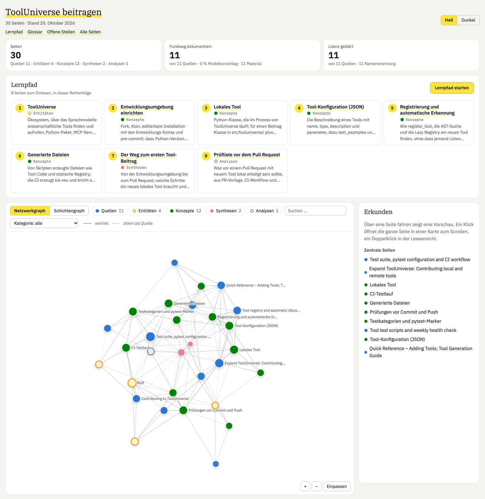
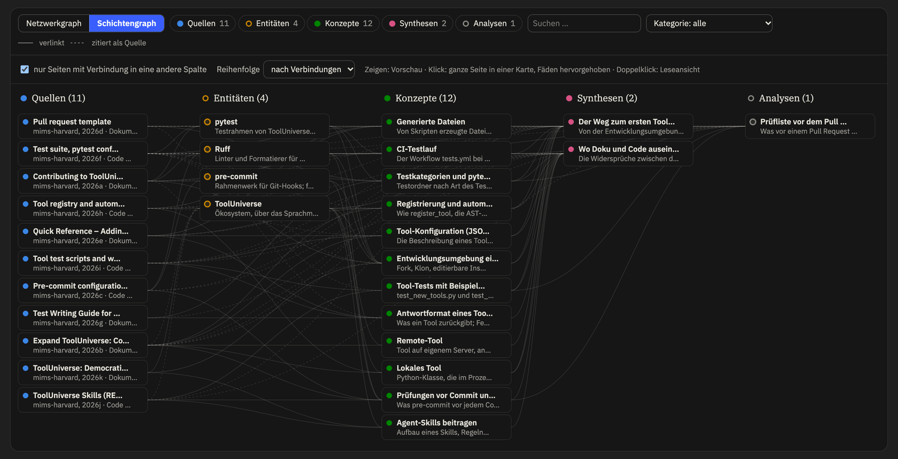
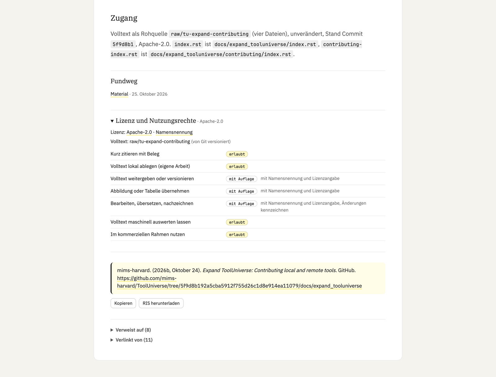

# okfw

Claude-Code-Plugin für Wissens-Wikis im [Open Knowledge Format v0.2](https://github.com/GoogleCloudPlatform/knowledge-catalog/blob/a8291a1a656669b8766fd4ff0f985505fb955e94/okf/SPEC.md)
(OKF), gepflegt nach dem LLM-Wiki-Muster von [pi-llm-wiki](https://github.com/zosmaai/pi-llm-wiki):
Markdown-Karten mit YAML-Frontmatter, unveränderliche Rohquellen, ein Ereignisstrom, generierte Indexe,
Belegpflicht für jede Sachaussage und ein HTML-Dashboard zum Lesen und Lernen.
okfw steht für Open Knowledge Format Wiki; OKF ist das Open Knowledge Format v0.2 (GoogleCloudPlatform/knowledge-catalog).

- **Skill** `okfw`: Arbeitsweise für Claude (Recall → Capture → Ingest → Retro → Lint), Beleg-,
  Lizenz- und Vertrauensregeln.
- **Kern** `skills/okfw/okfw.py`: CLI und Python-Bibliothek (`init`, `capture`, `new`, `body`,
  `rebuild`, `lint`, `verify`, `lizenz`, `rechte`, `dashboard` …). Alles Projektspezifische steht in
  einer `wiki.toml` im Projekt; ohne `wiki.toml` schreibt der Kern nichts.
- **Hooks**: Status beim Sitzungsstart, Schreibschutz für Rohquellen, Ereignisstrom und generierte
  Dateien, Ereignisprotokoll bei Write/Edit, Rebuild beim Stop. Sie wirken nur in Projekten mit
  `wiki.toml`.
- **Dashboard**: eine einzelne HTML-Datei ohne Nachladen aus dem Netz (Netzgraph, Lernpfad, Glossar,
  offene Stellen, Leseansicht mit Belegen und Literatur nach APA 7).
- **Quellen**: Das Plugin nimmt Quellen auf und belegt sie, enthält aber keine Literatursuche;
  Metadaten kommen per DOI, PMID oder arXiv-ID (`new source --doi`, `--pmid`, `--arxiv`).

Die Texte von Skill und Dokumentation sind deutsch.

## Dashboard

Startansicht mit Kennzahlen, dem Lernpfad in acht Schritten und dem Netzwerkgraphen aller Seiten:



Schichtengraph in dunkler Darstellung, von den Quellen bis zu den Analysen, mit den Verbindungen als Fäden:



Zeigen öffnet eine Vorschau der Seite und hebt ihre Verbindungen hervor, ein Klick heftet die ganze Seite als Karte an:


Quellenkarte in der Leseansicht mit Nutzungsrechten, APA-Angabe zum Kopieren und RIS-Export:



Beispiel-Wiki „ToolUniverse beitragen“, aufgebaut aus Dokumentation und Code von
[mims-harvard/ToolUniverse](https://github.com/mims-harvard/ToolUniverse) (Apache-2.0).

## Voraussetzungen

| Was | Version im Nachbau-Test | Wozu |
|---|---|---|
| [Claude Code](https://code.claude.com/docs) | 2.1.291 | Plugin, Skill, Hooks |
| [uv](https://docs.astral.sh/uv/) | 0.12.7 | startet Kern und Hooks; holt Python ≥ 3.11 und die Pakete aus dem Skriptkopf (PEP 723) |
| Python | ≥ 3.11 (im Test 3.14.7, von uv geholt) | Kern und Hooks; der Kern setzt uv voraus, uv holt ein passendes Python selbst, falls keins da ist |
| PyYAML ≥ 6.0, Markdown ≥ 3.5 | von uv beim ersten Start geholt | Frontmatter, Leseansicht |

Netz braucht der Kern beim ersten Start (PyPI, ggf. Python-Download durch uv) und sonst nur in Befehlen,
die dafür da sind: `new source --doi/--pmid/--arxiv` und `lizenz --fetch` (Crossref, PubMed, Europe PMC,
DataCite, OpenAlex, arXiv). Getestet unter macOS und Debian 12 (Container).

## Installation

```bash
claude plugin marketplace add sina-769/okfw
claude plugin install okfw@okfw
```

Statt `sina-769/okfw` geht auch ein lokaler Ordner: ein Klon des Repos oder ein Ordner mit
`.claude-plugin/marketplace.json`. Danach Claude Code neu starten (oder `/reload-plugins`).

Ohne Plugin geht es auch als Skill-Ordner: `skills/okfw/` nach `~/.claude/skills/okfw/` kopieren
und `skills/okfw/hooks/settings.example.json` in die `.claude/settings.json` des Projekts übernehmen.
Nicht beides zugleich, sonst laufen die Hooks doppelt.

## Erste Schritte

Im Projektordner (Pfad zum Kern aus der Plugin-Installation):

```bash
OKF=$(ls -d ~/.claude/plugins/cache/okfw/okfw/*/skills/okfw | tail -1)/okfw.py
uv run --quiet "$OKF" init --profile default        # wiki.toml und wiki/ anlegen
uv run --quiet "$OKF" capture <slug> --url URL --file PFAD --license NAME --license-url URL
uv run --quiet "$OKF" new source <slug> --title … --description … --access fulltext --set raw_packet=raw/<slug>
uv run --quiet "$OKF" rebuild && uv run --quiet "$OKF" lint
uv run --quiet "$OKF" dashboard                     # build/wiki-dashboard.html
```

Für ein Wiki über Projektdoku und Code gibt es `init --profile dokumentation`: Quellen mit den Unterarten
Dokumentation und Code, Lizenz und Rohquellen-Paket als Pflicht, fehlender Fundweg als Warnung.

Oder in Claude Code einfach um Wiki-Arbeit bitten; der Skill kennt die Befehle. Alle Befehle und
`wiki.toml`-Schlüssel: [skills/okfw/docs/konfiguration.md](skills/okfw/docs/konfiguration.md).

## Nachbau-Test

[tests/nachbau.sh](tests/nachbau.sh) installiert das Plugin in einer frischen Umgebung aus einem
Marketplace, legt ein Demo-Wiki aus zwei frei lizenzierten Quellen an (OKF-Spezifikation, Apache-2.0;
README von pi-llm-wiki, MIT; beide über die GitHub-API auf einen Commit gepinnt und per SHA-256
geprüft), erfasst sie, schreibt Karten, führt `rebuild`, `lint` und `dashboard` aus und ruft die Hooks
mit genau den Befehlen aus `hooks/hooks.json` auf. Jeder Schritt landet mit Befehl, Ausgabe und
Exit-Code in einem Protokoll.

```bash
docker build -t okfw-nachbau -f tests/Dockerfile tests
docker run --rm -v "$PWD:/src:ro" -v "$PWD/.nachbau:/out" okfw-nachbau /src /out/lauf-$(date +%H%M%S)
```

Letztes Protokoll: [tests/protokoll-2026-10-25.md](tests/protokoll-2026-10-25.md).

## Lizenz und Dank

okfw steht unter der [MIT-Lizenz](LICENSE). Ausgenommen sind die mitgelieferten Schriften und der
Zitierstil mit eigener Lizenz; sie und die Vorbilder nennt [NOTICE.md](NOTICE.md).
